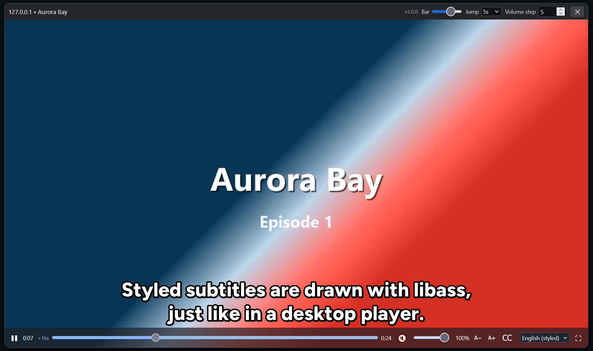
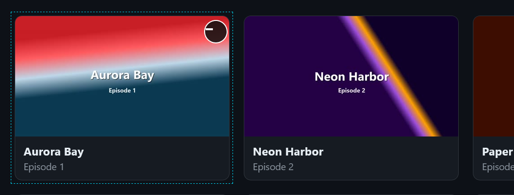
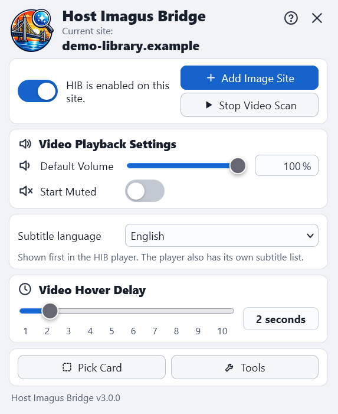
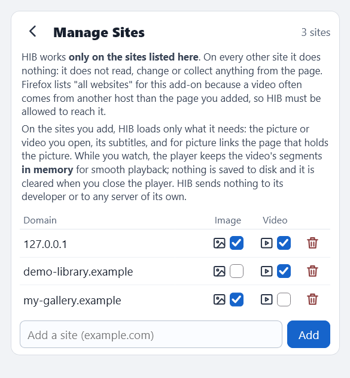
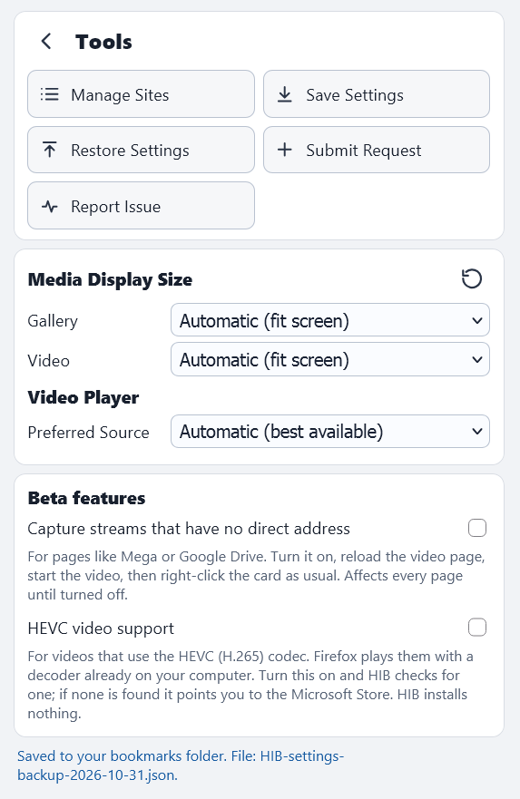
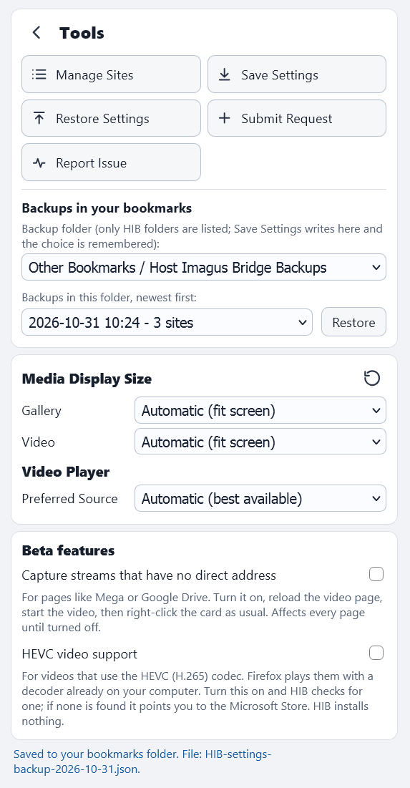

# Host Imagus Bridge (HIB)

**Open full-size pictures and play videos from the sites you choose. A companion for Imagus Reborn, now with its own video player, styled subtitles and one-click backups.**

> **HIB works only on the sites you add** (toolbar button → Tools → Manage Sites). On every other site it does nothing: it does not read, change or collect anything from the page. HIB has no account, no analytics and sends nothing to any server of its own.

**Documentation:** [Tutorial](https://github.com/molitar/host-imagus-bridge/wiki/Tutorial) (your first video, step by step, with pictures) · [User Guide](https://github.com/molitar/host-imagus-bridge/wiki/User-Guide) · [Installing a Preview Build](https://github.com/molitar/host-imagus-bridge/wiki/Installing-a-Preview-Build) · [Wiki](https://github.com/molitar/host-imagus-bridge/wiki)

## What it is

Host Imagus Bridge is a Firefox add-on that works next to [Imagus Reborn](https://addons.mozilla.org/firefox/addon/imagus-reborn/).

* **Pictures:** pages that wrap a picture behind a second page (image hosts, link shorteners, gallery pages) are resolved for you, and HIB's own gallery steps in when Imagus cannot show the picture.
* **Videos:** hover a card, wait for the ready mark, right-click, and the **HIB player** opens on top of the page: no new tab, no ads, no leaving the list.

## What's new in 3.0.2 and 3.0.1

Bug-fix releases on top of 3.0.0 (details in the [CHANGELOG](CHANGELOG.md)):

* **3.0.2:** the blocked-autoplay warning shows as soon as you hover a card; the **!** mark is back for a dead link, a site that is down or an unsupported video (the apostrophe is only for a landing page); Pick Card outlines are 4 px again; Diagnostics mode is off when its section is hidden; slow servers are handled better.
* **3.0.1:** a **Resolution** selector (360p to 1080p) on sites that offer several resolutions and a **Quality** selector for HLS streams; the best quality is played first; the seek lock is shorter; a broken streaming mirror no longer stops a video from opening; A− / A+ also resize styled subtitles; the optional **Download button** (off by default).

## What's new in 3.0.0

2.1.5 handled pictures. **3.0.0 is the video release**, and it adds a lot around it:

* 🆕 **HIB video player** — MP4, HLS and DASH, resume where you stopped, keyboard control, volume and jump steps.
* 🆕 **Hover to scan, right-click to play** — HIB checks the video behind a card and marks it when it is ready.
* 🆕 **Styled subtitles** — ASS / SSA drawn with libass, plus SRT and VTT; language detection, a default language, size and on/off controls.
* 🆕 **Tools page** — Manage Sites, display sizes, preferred source, Save / Restore Settings, Report Issue, Submit Request.
* 🆕 **Backups inside the toolbar** — settings saved as dated bookmarks in one HIB folder, restored with one click. No file chooser, no copy and paste.
* 🆕 **Report Issue / Submit Request** — a pre-filled GitHub page plus a diagnostic report for you to attach. Nothing is posted by HIB.
* 🆕 **Beta features** (off by default) — *Capture streams* for pages with no direct video address, and *HEVC video support*.
* 🆕 **Resilient picture finding** — resolvers keep their exact pattern for a known host and fall back to a shared picture finder when a site changes its pages; a dead image host no longer blocks the next image.
* 🆕 **imgpv.com support updated** for the site's new page layout.

Full list: [CHANGELOG](CHANGELOG.md).

## Features

### Video
* Hover a card for the hover delay (1–10 seconds, your choice); a spinner shows while the video is checked, then the card shows a **−** (ready to play), an **'** (a landing page with no video of its own) or a **!** (a dead link, a site that is down or an unsupported video). Right-click it to open the player. `Ctrl + Right Shift` does the same for the card under the pointer; `Ctrl + right-click` stays with Imagus Reborn.
* **Scan Site for Videos**: a site is registered for good only after a real playback has been verified, so a wrong guess never sticks.
* **Pick Card**: point at the cards HIB should treat as videos on a page it did not recognise.
* Plays **MP4, HLS and DASH**; seek bar with buffered range, volume, mute, full screen.
* Space = play / pause, ← / → = jump (5–30 s), ↑ / ↓ = volume (step set in the title bar), **Bar** = control-bar opacity.
* **Resume** position per episode.
* Video pieces are kept in **memory only**, one video at a time, and cleared when the player closes. Nothing is saved to disk unless you use the optional **Download button** (Tools → Beta features, off by default), which saves the video, the subtitle language you are watching and a separate sound file if the stream has one.
* If Firefox blocks autoplay for the site, HIB tells you at once and where to allow it (see the [Tutorial](https://github.com/molitar/host-imagus-bridge/wiki/Tutorial)).
* HEVC (H.265) plays through a decoder already on your computer (*Beta*; HIB installs nothing).

### Subtitles
* **Styled ASS / SSA** with libass — colours, fonts, sizes, positions and fades as the author intended — plus **SRT and VTT**.
* HIB finds the subtitles of a video from the files the page loads, the files the page lists, and the usual names next to the video, and offers every track with its language.
* **Default language** (English, first available, off, or one of 15 more), **CC** on/off, **A− / A+** size.
* A default font (Figtree, SIL Open Font License) is bundled; if the video page loads its own fonts, HIB uses them for ASS subtitles. HIB never fetches a font from an unrelated website.

### Pictures
* **Imagus first**: Imagus handles a preview first; HIB steps in after a confirmed failure. Your own Sieves keep priority.
* **Native gallery** with previous / next, an image counter, Escape to close, and configurable size limits that keep the aspect ratio.
* Wrapper and image-host pages are resolved (imgpv, ouo.io chains, TurboImageHost, XXPICS, DLsite galleries, and generic wrapper pages).
* **Layout fallback**: when a site changes its pages, resolvers fall back to a shared picture finder (schema.org `ImageObject`, `og:image`, large images, picture links, addresses in the page's scripts) and note **LAYOUT CHANGED** in the log.
* **Dead hosts stop quickly**: a host that does not answer gets a red "site down" tag, its spinner and helper tab are closed, and the next image opens at once.

### Sites and settings
* **Manage Sites**: one short list with an **Image** and a **Video** checkbox per site.
* **Media display size** (gallery / video): fit the screen, original, or custom.
* **Preferred source** for videos with more than one: automatic, MP4 or HLS.
* **Toolbar popup**: default volume, start muted, subtitle language, hover delay.

### Backups that survive a reinstall
* **Save Settings** writes a dated bookmark in one folder you choose (default *Other Bookmarks / Host Imagus Bridge Backups*); the newest 14 are kept.
* **Restore Settings** lists only HIB backups, newest first, with the number of sites in each.
* Restoring puts back exactly the settings the backup describes.
* HIB touches only bookmarks whose title starts with `HIB settings `; your other bookmarks are never read or changed.

### Report a problem or ask for a site
* **Report Issue**: opens a pre-filled GitHub issue and saves a diagnostic report on your computer for you to attach.
* **Submit Request → Request Site / Request Feature**.
* Address query parts are removed; cookies, logins and passwords are never collected.

## Screenshots

*All screenshots use a made-up demo library and generated clips; no real site or personal data is shown.*

| | |
|---|---|
|  |  |
|  |  |
|  |  |

## Installation

1. Install it from [addons.mozilla.org](https://addons.mozilla.org/en-US/firefox/addon/host-imagus-bridge/), or download `host_imagus_bridge-<version>.xpi` from the [Releases](https://github.com/molitar/host-imagus-bridge/releases) page (pre-releases are marked; see [Installing a Preview Build](https://github.com/molitar/host-imagus-bridge/wiki/Installing-a-Preview-Build)).
2. Signed releases install in regular Firefox. For an unsigned pre-release use Firefox Developer Edition, Nightly or ESR with `xpinstall.signatures.required` set to `false`, or load it temporarily from `about:debugging`.
3. Install [Imagus Reborn](https://addons.mozilla.org/firefox/addon/imagus-reborn/) as well: HIB complements it.
4. Open the toolbar button → **Tools → Manage Sites** and add the sites you want HIB to work on.

Installs **over 3.0.x and 2.1.5** (same add-on): your settings are kept. Firefox may ask you to approve the new permissions when you update.

## Compatibility

* Firefox desktop **115 or newer** (Manifest V2).
* Works alongside Imagus Reborn; HIB does not replace it.

## Permissions

| Permission | Why |
|---|---|
| All websites | Reach the sites you add and the other hosts their videos and pictures come from. Page scripts check your site list first and do nothing elsewhere. |
| `tabs`, `webNavigation` | Open and close HIB's own short-lived helper tabs; close stray ones. |
| `webRequest`, `webRequestBlocking` | Send the Referer that some video hosts require for addresses HIB has verified; recognise video and subtitle addresses. |
| `storage`, `unlimitedStorage` | Your settings, site list, display sizes, resume positions. |
| `bookmarks` | The settings backup only (`HIB settings …`). |
| `downloads` | Save the files *you* ask for: the report file, a settings backup, a diagnostic capture. Nothing is downloaded from the sites you visit. |
| `cookies` | Read a protected video's own cookie so the player can fetch its key; clear oversized link-shortener cookies. Never stored or sent. |
| `alarms`, `activeTab` | A timer that clears the in-memory video cache; toolbar actions. |

Data collection: **none**.

## Source code

Plain, readable JavaScript with no build step. Third-party code in the package: dash.js 4.7.4 (BSD-3-Clause), hls.js 1.7.3 (Apache-2.0), @jellyfin/libass-wasm 4.2.4 (official files), and the Figtree font (SIL OFL 1.1).

## Original project

Host Imagus Bridge is a companion to **Imagus Reborn** and builds on it; it is a separate add-on.

## License

GNU General Public License v3.0 — see [LICENSE](LICENSE).

## Community & Support

* New to HIB? Start with the [Tutorial](https://github.com/molitar/host-imagus-bridge/wiki/Tutorial) and the [User Guide](https://github.com/molitar/host-imagus-bridge/wiki/User-Guide).
* Found a bug or want a site supported? Use **Tools → Report Issue** / **Submit Request** in the add-on, or open an [issue](https://github.com/molitar/host-imagus-bridge/issues).
